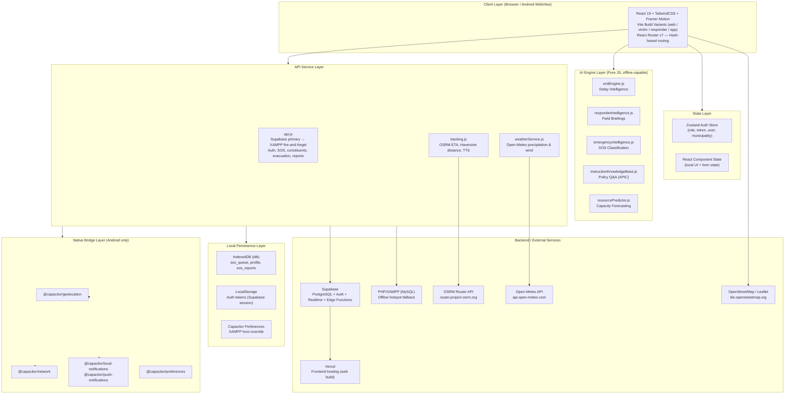
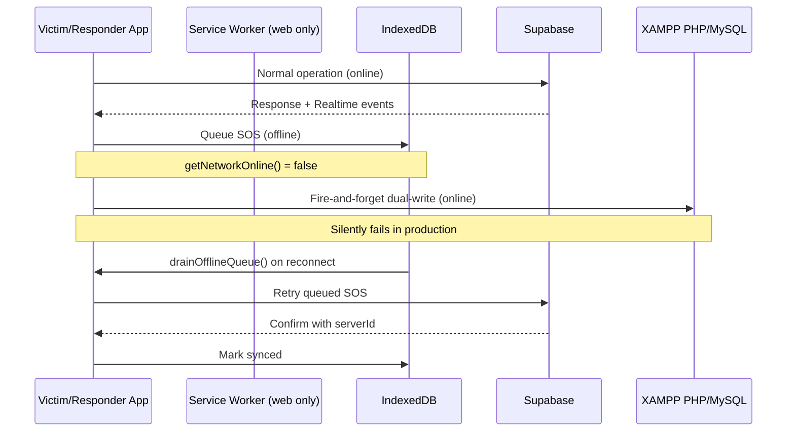

# SurvAIve PH – Complete System Architecture and Technical Specifications

**Version:** 3.0 (November 2026)
**Classification:** Technical Reference Document
**Audience:** Developers, System Analysts, Researchers, Future Maintainers

---

## Table of Contents

1. [Project Overview](#1-project-overview)
2. [Layered System Architecture](#2-layered-system-architecture)
3. [System Actors and User Roles](#3-system-actors-and-user-roles)
4. [Functional Specifications](#4-functional-specifications)
5. [Software Specifications](#5-software-specifications)
6. [Hardware Specifications](#6-hardware-specifications)
7. [Database and Data Management](#7-database-and-data-management)
8. [Communication and Integration Architecture](#8-communication-and-integration-architecture)
9. [AI Architecture and Capabilities](#9-ai-architecture-and-capabilities)
10. [Security and Access Control](#10-security-and-access-control)
11. [System Workflows and Use Cases](#11-system-workflows-and-use-cases)
12. [Non-Functional Requirements](#12-non-functional-requirements)
13. [Deployment and Infrastructure Requirements](#13-deployment-and-infrastructure-requirements)
14. [Testing and Evaluation Requirements](#14-testing-and-evaluation-requirements)
15. [Other Important Technical Details](#15-other-important-technical-details)

---

## 1. Project Overview

### 1.1 Background

SurvAIve PH is a capstone disaster-response coordination platform developed for Local Government Unit (LGU) and Department of Science and Technology (DOST) use in the Philippines. The pilot deployment targets Siargao Island in Surigao del Norte — an area regularly affected by typhoons, flooding, and coastal hazards.

The project addresses a critical gap in municipal disaster response: the lack of a unified, real-time digital tool that connects community members in distress, field rescue teams, response agencies, and administrative coordinators during active emergency events.

### 1.2 Purpose and Objectives

| Objective | Description |
|---|---|
| Centralize emergency reporting | Provide a single, structured channel for SOS submissions that eliminates phone-tag and verbal relays |
| Accelerate responder dispatch | AI-assisted priority scoring ensures critical incidents receive responders first |
| Enable real-time coordination | Live responder GPS tracking, distance monitoring, and status updates keep all parties informed |
| Support offline operations | Local caching and an IndexedDB queue preserve SOS submissions during connectivity interruptions |
| Provide AI-powered decision support | Rule-based AI modules assist responders and administrators without requiring internet access to external AI APIs |
| Maintain a complete incident audit trail | Every status transition, login, and administrative action is logged for accountability |

### 1.3 Scope

**In scope:**
- Emergency SOS reporting by community members (registered and anonymous)
- Real-time responder tracking and distance monitoring
- Voice-based proximity announcements during rescue approach
- AI-driven priority assessment and delay intelligence
- LGU administrator command-and-control dashboard
- Response agency coordination portal
- Provincial-level oversight reports
- Evacuation center management
- Offline queueing and automatic synchronization
- Android native applications (Capacitor)
- Progressive Web App for administrative users

**Out of scope (explicitly removed):**
- BLE / Wi-Fi Direct mesh communication
- YOLO11 computer vision integration
- Photo Mode SOS submissions
- Dual Mode (simultaneous online/offline) SOS operations

### 1.4 Key Features

- **Multi-role platform** — Five distinct actor types with separate views and permissions
- **Four build variants** — Dedicated optimized APKs for victim and responder roles; unified web PWA for admin/agency
- **AI-first emergency intelligence** — Entirely offline, rule-based AI: priority scoring, delay analysis, field briefings, policy Q&A
- **Online-first with graceful offline fallback** — Supabase is the authoritative backend; IndexedDB queue preserves transactions during connectivity loss
- **Real-time GPS tracking** — Supabase Realtime feeds live responder coordinates to both victim and admin views
- **Emergency Response Delay Intelligence (ERDI)** — Tracks per-stage response time (pending → acknowledged → en route → on scene) and surfaces delay warnings to all parties
- **OSRM road-based ETA** — Uses real road geometry (not crow-fly distance) for accurate arrival time estimates
- **Weather-aware risk assessment** — Open-Meteo precipitation and wind data modulate AI priority scores and delay baselines

### 1.5 Intended Users

| User Type | Organization | Technical Proficiency |
|---|---|---|
| Community member (victim) | Barangay residents, tourists | Low — mobile app, simple UI |
| Field responder | MDRRMO rescue teams, BFP, PNP | Low–Medium — mobile app |
| Response agency officer | MDRRMO, BFP, hospital, PCG | Medium — web or PWA |
| LGU administrator (DRRM) | Municipal DRRM Office | Medium — web PWA |
| DOST provincial director (Superadmin) | DOST Regional / Provincial | Medium — web PWA |

---

## 2. Layered System Architecture

### 2.1 Architecture Diagram



### 2.2 Layer Descriptions

#### Client Layer
The presentation layer. All UI components are written in React 19 with JSX, styled using TailwindCSS v4, and animated with Framer Motion. The application is built with Vite 8 into four variants (see §13.1). Routing uses React Router v7's `createHashRouter` — hash-based routing is mandatory for Capacitor WebView compatibility.

#### State Layer
Zustand v5 manages global authentication state: `role`, `token`, `user` object, `municipality`, `isAuthenticated()`, and `logout()`. Component-local state (form values, loading flags, panel toggles) lives in React `useState`/`useReducer`.

#### AI Engine Layer
Six pure JavaScript modules in `frontend/src/lib/ai/`. They have zero network dependencies, work fully offline, and produce deterministic outputs. See §9 for full details.

#### API Service Layer
`api.js` is the unified backend abstraction. It routes all data operations — supporting five HTTP verbs (GET, POST, PUT, DELETE, plus special auth paths) — to Supabase as the primary source of truth. XAMPP PHP/MySQL is called as a secondary fire-and-forget dual-write for offline/hotspot support. `tracking.js` and `weatherService.js` are independent service modules for navigation and weather data respectively.

#### Local Persistence Layer
Three distinct storage mechanisms:
- **IndexedDB** (`idb` v8): Durable offline SOS queue, profile cache, and report cache. Survives app restarts and service worker updates.
- **LocalStorage**: Supabase session storage (managed by the Supabase JS client).
- **Capacitor Preferences** (Android SharedPreferences): Stores the user-configurable XAMPP host IP.

#### Native Bridge Layer (Android only)
Capacitor v8 bridges JavaScript to Android APIs. Used by the victim and responder builds for GPS location polling, network connectivity events, and local/push notifications. Not present in the web (PWA) build.

#### Backend / External Services
| Service | Role | Protocol |
|---|---|---|
| Supabase (PostgreSQL) | Primary database, auth, realtime, edge functions | HTTPS / WSS |
| PHP/XAMPP (MySQL) | Offline hotspot fallback for victim/responder mobile apps | HTTP (LAN only) |
| OSRM Router | Road-network ETA and route geometry | HTTPS |
| Open-Meteo | Live precipitation and wind speed for weather risk | HTTPS |
| OpenStreetMap / Leaflet | Tile-based map rendering | HTTPS |
| Vercel | CDN hosting for the web/admin PWA build | HTTPS |

---

## 3. System Actors and User Roles

### 3.1 Role Overview

| Role Identifier | Display Name | Authentication Method | Primary Device |
|---|---|---|---|
| `victim` | Community Member / Victim | Victim ID + PIN + Device Key (PBKDF2) | Android smartphone |
| `responder` | Field Responder | Contact number + Password (Supabase Auth) | Android smartphone |
| `response_agency` | Response Agency | Contact number + Password (Supabase Auth) | Web browser or PWA |
| `admin` | LGU Administrator (DRRM) | Contact number + Password (Supabase Auth) | Web browser (PWA) |
| `superadmin` | DOST Provincial Director | Contact number + Password (Supabase Auth) | Web browser (PWA) |

### 3.2 Victim / Community User

| Attribute | Detail |
|---|---|
| **Organization** | Barangay residents, domestic workers, tourists |
| **Registration** | Self-registration via app; device-bound credentials (Victim ID + 4-digit PIN + device key hash) |
| **Authentication** | Offline-capable: PBKDF2 PIN verification against locally-stored hash |
| **Scope** | Own SOS reports only; no access to other users' data |
| **Data access** | Own `sos_reports`, own `victims` profile, public `evacuation_centers` |
| **Permissions** | Submit SOS, update Quick Safety Status, view own response tracking, leave rescue feedback |

### 3.3 Field Responder

| Attribute | Detail |
|---|---|
| **Organization** | MDRRMO rescue teams, Barangay Emergency Response Teams (BERT) |
| **Registration** | Created by Admin via StaffManagement page |
| **Authentication** | Supabase Auth (email: `{contact}@survaive.ph`) + password; offline fallback via PBKDF2 cached credentials |
| **Scope** | Assigned SOS incidents in their municipality |
| **Data access** | Filtered `sos_reports`, own responder profile, `evacuation_centers`, `sos_status_events` |
| **Permissions** | View assigned SOS queue, update rescue status, record field notes, submit GPS location, view ERDI panel |

### 3.4 Response Agency

| Attribute | Detail |
|---|---|
| **Organization** | BFP (fire), PNP (police/security), hospitals, PCG (maritime), MDRRMO |
| **Registration** | Created by Admin via StaffManagement page |
| **Authentication** | Supabase Auth (`{contact}@survaive.ph`) |
| **Scope** | Filtered by `agency_type` — only SOS reports matching their service type are shown |
| **Data access** | Type-filtered `sos_reports`, agency profile, analytics for their service scope |
| **Permissions** | View service-scoped incidents, acknowledge/respond, view analytics, leave service feedback |

### 3.5 LGU Administrator (DRRM)

| Attribute | Detail |
|---|---|
| **Organization** | Municipal Disaster Risk Reduction and Management Office (MDRRMO) |
| **Registration** | Created by Superadmin |
| **Authentication** | Supabase Auth |
| **Scope** | All incidents within their municipality |
| **Data access** | All `sos_reports` for municipality, all constituent `victims`, all `responders`, `admins`, `response_agencies`, `evacuation_centers`, `activity_logs`, `province_reports` |
| **Permissions** | Full command center, constituent management, staff creation, evacuation center management, SITREP generation, AI analytics, APIC policy Q&A, audit logs |

### 3.6 Superadmin (DOST Provincial Director)

| Attribute | Detail |
|---|---|
| **Organization** | DOST Regional / Provincial Office |
| **Registration** | Seeded at database initialization |
| **Authentication** | Supabase Auth |
| **Scope** | All municipalities within province |
| **Data access** | Province-level `province_reports`, all admins across province, escalations |
| **Permissions** | Province-level Emergency Ops Reports, cross-municipality comparison, oversight of all LGU admins |

---

## 4. Functional Specifications

### 4.1 Victim Modules

| Module | Route | Key Functions |
|---|---|---|
| Landing / Auth | `/` | Role selection (community member, staff), entry point |
| Registration | `/signup` | Device-bound registration: name, contact, barangay, household, vulnerabilities, PIN, device key hash |
| Profile Login | `/login` | Victim ID + PIN + device key authentication; offline-capable via PBKDF2 |
| Guest Challenge | `/guest` | Anonymous quick safety status (SAFE/UNSAFE) without full registration |
| Home Screen | `/home` | Dashboard: Quick Safety Status, recent SOS, evacuation center list, emergency contacts |
| SOS Center | `/sos` | List of own SOS reports with status and priority labels |
| SOS Report | `/sos/new` | Structured emergency report: incident type, people count, age group, special conditions, GPS location, service type routing, notes |
| Incident History | `/sos/history` | Timeline of all past SOS submissions |
| Response Tracking List | `/sos/tracking` | List of active SOS with responder status summaries |
| Response Tracking | `/sos/:id` | Per-SOS detail: responder GPS map, real-time distance, ERDI delay panel, voice announcements |
| Rescue Feedback | `/sos/:id/feedback` | Post-rescue rating and narrative feedback for the assigned responder |
| Victim Assistant | `/assistant` | AI-powered Q&A — emergency instructions, evacuation guidance, first aid tips (rule-based) |
| Local Map | `/map` | Leaflet map showing evacuation centers, own SOS location, road-based ETA from OSRM |
| Victim Settings | `/settings` | Profile update, XAMPP host IP configuration, app preferences |

### 4.2 Responder Modules

| Module | Route | Key Functions |
|---|---|---|
| Staff Login | `/` | Contact number + password authentication; offline PBKDF2 fallback |
| Responder Home | `/responder` | Dashboard: active incident count, duty status toggle, recent priority incidents |
| Victim Queue | `/responder/queue` | Prioritized list of SOS incidents filtered by municipality; acknowledge → en route → on scene workflow |
| Rescue Detail | `/responder/rescue/:id` | Full incident view: victim profile, GPS location, field notes editor, rescue status update, ERDI delay panel |
| Field Map | `/responder/map` | Leaflet map of all active SOS in municipality, responder's own location, OSRM routing |
| Responder Assistant | `/responder/assistant` | AI field briefing (rule-based): incident summary, priority factors, missing info checklist |
| Responder History | `/responder/queue/history` | Archive of completed and closed rescue operations |
| Responder Settings | `/responder/settings` | Profile, duty status, XAMPP host IP, notification preferences |

### 4.3 Response Agency Modules

| Module | Route | Key Functions |
|---|---|---|
| Agency Login | (via `/staff-login`) | Contact + password via Supabase Auth |
| Agency Command Center | `/agency` | Service-scoped SOS dashboard (filtered by `agency_type`) |
| Agency Victim Table | `/agency/victims` | Victim records for agency-relevant incidents |
| Agency Emergency Report | `/agency/reports` | Incident report summary scoped to agency type |
| Agency Analytics | `/agency/analytics` | AI-computed analytics for the agency's incident scope |
| Agency Service Feedback | `/agency/service-feedback` | View community feedback for the agency's rescue responses |
| Agency Settings | `/agency/settings` | Agency profile, notification preferences |

### 4.4 LGU Administrator (DRRM) Modules

| Module | Route | Key Functions |
|---|---|---|
| Staff Login | `/staff-login` | Contact + password via Supabase Auth |
| Command Center | `/admin` | Real-time SOS feed, map, Delay Alerts accordion, responder tracker, resource forecast |
| Victim Table | `/admin/victims` | Live list of all SOS reports with priority, status, responder assignment |
| Constituent Registry | `/admin/constituents` | Registered victim/community member database; create, update, deactivate accounts |
| Situational Awareness | `/admin/analytics` → `SituationalAwareness` | Zone analysis, AI insights, Delay Intelligence tab (ERDI tier summary) |
| AI Analytics | `/admin/analytics` → `AdminAnalytics` | Charts: priority distribution, status breakdown, time-series SOS trends |
| AI Policy Intelligence Center | `/admin/policy-intelligence` | DRRM policy Q&A powered by local knowledge base; NDRRMC protocol guidance |
| Responders View | `/admin/responders` | Responder roster, duty status, assignment overview |
| Staff Management | `/admin/staff` | Create and manage admin, responder, and agency accounts; password reset |
| Evacuation Centers | `/admin/evacuation-centers` | Register, update, assess, track occupancy of evacuation centers |
| SITREP | `/admin/sitrep` | Situation report generator: AI-assisted narrative summary of active emergency |
| Emergency Report | `/admin/emergency-report` | Structured incident report for formal submission |
| Barangays Comparison | `/admin/barangays-comparison` | Side-by-side SOS and responder metrics per barangay |
| Login Credentials | `/admin/credentials` | Manage staff login credentials and password resets |
| Admin Settings | `/admin/settings` | Admin profile and preferences |
| Audit Logs | `/admin/audit-logs` | Full chronological log of all system actions (logins, updates, deletes) |
| Response Feedback | `/admin/response-feedback` | Aggregate view of post-rescue feedback scores |
| Emergency Ops Reports | `/admin/emergency-ops` | Superadmin province-level daily snapshot reports |

### 4.5 Superadmin Modules

The Superadmin role shares the web build with the Admin role. Elevated access is enforced via row-level security on `province_reports` and cross-municipality query parameters.

| Module | Route | Key Functions |
|---|---|---|
| Emergency Ops Reports | `/admin/emergency-ops` → `EmergencyOpsReports` | Province-level daily aggregate snapshots (total, critical, rescued, reporting municipalities); chart of 90-day history |

---

## 5. Software Specifications

### 5.1 Frontend Runtime

| Technology | Version | Role |
|---|---|---|
| React | 19.2.6 | UI component framework |
| React DOM | 19.2.6 | DOM renderer |
| React Router DOM | 7.15.1 | Hash-based client-side routing |
| Zustand | 5.0.13 | Global auth state management |
| TailwindCSS | 4.3.0 | Utility-first CSS |
| Framer Motion | 12.40.0 | Declarative animations and transitions |
| Lucide React | 1.16.0 | SVG icon library |
| React Hook Form | 7.76.1 | Form state and validation |

### 5.2 Data and Networking

| Package | Version | Role |
|---|---|---|
| @supabase/supabase-js | 2.110.1 | Database, auth, realtime client |
| idb | 8.0.3 | IndexedDB wrapper (offline queue) |
| axios | 1.16.1 | HTTP client (secondary, used in some components) |

### 5.3 Mapping and Visualization

| Package | Version | Role |
|---|---|---|
| leaflet | 1.9.4 | Interactive map engine |
| react-leaflet | 5.0.0 | React bindings for Leaflet |
| recharts | 3.8.1 | Data visualization (charts, timelines) |

### 5.4 Native Android (Capacitor)

| Package | Version | Role |
|---|---|---|
| @capacitor/core | 8.5.0 | Core JS-to-native bridge |
| @capacitor/android | 8.5.0 | Android platform implementation |
| @capacitor/cli | 8.4.3 | Build toolchain CLI |
| @capacitor/geolocation | 8.2.2 | GPS location access |
| @capacitor/network | 8.0.1 | Connectivity change events |
| @capacitor/preferences | 8.0.1 | Persistent key-value store (Android SharedPreferences) |
| @capacitor/local-notifications | 8.3.1 | Scheduled / triggered local alerts |
| @capacitor/push-notifications | 8.1.2 | FCM remote push notifications |

### 5.5 UI Utilities

| Package | Version | Role |
|---|---|---|
| html5-qrcode | 2.3.8 | QR code camera scanner |
| qrcode.react | 4.2.0 | QR code generator component |
| @radix-ui/react-dialog | 1.1.15 | Accessible modal dialogs |
| @radix-ui/react-dropdown-menu | 2.1.16 | Accessible dropdowns |
| @radix-ui/react-select | 2.2.6 | Accessible select inputs |
| @radix-ui/react-tooltip | 1.2.8 | Accessible tooltips |

### 5.6 Build Toolchain

| Tool | Version | Role |
|---|---|---|
| Vite | 8.0.12 | Build tool and dev server |
| vite-plugin-pwa | 1.3.0 | PWA manifest and Workbox service worker generation |
| @tailwindcss/vite | 4.3.0 | Tailwind integration with Vite |
| @vitejs/plugin-react | 6.0.1 | React Fast Refresh and JSX transform |
| ESLint | 10.3.0 | Static code analysis |
| TypeScript | 7.0.2 | Type definitions (devDependency) |

### 5.7 Backend (PHP/XAMPP — Offline Hotspot Layer)

| Technology | Version | Role |
|---|---|---|
| PHP | 8.x (XAMPP) | Server-side request handling |
| MySQL | 8.0 (XAMPP) | Offline relational database |
| PDO | — | PHP database abstraction |
| JSON Web Tokens (HS256) | — | Offline authentication (manual PHP implementation) |

### 5.8 External APIs

| Service | Endpoint | Protocol | Used For |
|---|---|---|---|
| Supabase | `https://{project}.supabase.co` | HTTPS / WSS | Primary DB, auth, realtime |
| Open-Meteo | `https://api.open-meteo.com/v1/forecast` | HTTPS | Weather risk (precipitation, wind) |
| OSRM Router | `https://router.project-osrm.org/route/v1/driving/` | HTTPS | Road-based ETA, route geometry |
| OpenStreetMap | `https://{s}.tile.openstreetmap.org/{z}/{x}/{y}.png` | HTTPS | Map tiles |
| Google Fonts | `https://fonts.googleapis.com/` | HTTPS | Typography |
| Vercel CDN | Configured via Vercel project | HTTPS | Frontend hosting |

### 5.9 Development Environment

| Requirement | Specification |
|---|---|
| Node.js | ≥ 18.x LTS |
| npm | ≥ 9.x |
| Java Development Kit | ≥ 17 (for Android builds) |
| Android Studio | Hedgehog or later |
| XAMPP | 8.2+ (optional — for local PHP/MySQL) |
| Supabase account | Required for cloud deployment |
| Vercel account | Required for web PWA deployment |

---

## 6. Hardware Specifications

### 6.1 Victim / Community Member (Android App)

| Parameter | Minimum | Recommended |
|---|---|---|
| OS | Android 8.0 (API 26) | Android 12.0+ (API 31+) |
| RAM | 2 GB | 4 GB+ |
| Storage | 100 MB free | 500 MB+ free |
| CPU | Quad-core 1.4 GHz | Octa-core 2.0 GHz+ |
| GPS | Required | Required (high-accuracy mode) |
| Internet | 3G / edge (SOS upload) | 4G LTE / Wi-Fi |
| Screen | 5.0" 720p | 6.0"+ 1080p |
| Battery | 3000 mAh | 4000 mAh+ |
| Camera | Not required | — |

> **Note:** For offline/hotspot mode, the victim device must connect to the admin's Wi-Fi hotspot. No internet is required in this mode; LAN connectivity to `192.168.43.1` (default hotspot gateway) is sufficient.

### 6.2 Field Responder (Android App)

Same minimum requirements as Victim. Additionally:

| Parameter | Specification |
|---|---|
| GPS precision | Required for real-time location updates |
| Screen size | ≥ 5.5" recommended for field use |
| Battery | ≥ 4000 mAh for extended fieldwork |
| Ruggedness | IP67 dust/water resistance preferred |
| Network | Active data connection required for real-time tracking |

### 6.3 Response Agency / LGU Administrator / Superadmin (Web Browser)

| Parameter | Minimum | Recommended |
|---|---|---|
| Device | Desktop PC or laptop | Desktop/laptop with large monitor |
| OS | Windows 10, macOS 11, Ubuntu 20.04 | Windows 11 / macOS 14 |
| Browser | Chrome 110+, Firefox 110+, Edge 110+ | Chrome latest |
| RAM | 4 GB | 8 GB+ |
| Display | 1280×768 | 1920×1080+ |
| Internet | 3 Mbps | 10 Mbps+ (real-time map and updates) |

### 6.4 XAMPP Server Machine (Admin Offline Hotspot — Optional)

| Parameter | Specification |
|---|---|
| OS | Windows 10/11 (XAMPP) |
| CPU | Dual-core 2.0 GHz+ |
| RAM | 4 GB |
| Storage | 10 GB free |
| Software | XAMPP 8.2+ with Apache + MySQL |
| Network | Wi-Fi adapter capable of hotspot broadcasting |

> The admin's machine runs XAMPP to serve the PHP backend over a local Wi-Fi hotspot. Mobile devices (victim and responder apps) connect to this hotspot to submit SOS reports when internet connectivity is unavailable.

### 6.5 Networking Equipment

| Item | Purpose |
|---|---|
| Wi-Fi hotspot (mobile phone or router) | LAN for offline hotspot mode |
| Internet connection (broadband/4G) | Required for Supabase-dependent features |
| Android hotspot (192.168.43.1) | Default gateway IP for XAMPP server |

---

## 7. Database and Data Management

### 7.1 Database Architecture Overview

SurvAIve PH uses a **three-tier storage model**:

```
┌────────────────────────────────────┐
│   Supabase PostgreSQL (Primary)    │  ← Authoritative source of truth
│   Cloud-hosted, always current     │
└────────────────────────────────────┘
            ↑  sync / dual-write
┌────────────────────────────────────┐
│   MySQL / XAMPP (Secondary)        │  ← Offline hotspot fallback
│   Local admin machine              │
└────────────────────────────────────┘
            ↑  queue → drain
┌────────────────────────────────────┐
│   IndexedDB (Client-side)          │  ← Pending queue + UI cache
│   Per-device browser storage       │
└────────────────────────────────────┘
```

### 7.2 Supabase PostgreSQL Schema

#### Core Identity Tables

| Table | Key Columns | Purpose |
|---|---|---|
| `superadmins` | id, name, contact_number, gmail, province, password_hash, status, trust_score | DOST provincial director accounts |
| `admins` | id, name, contact_number, gmail, province, municipality, password_hash, status | DRRM municipal administrator accounts |
| `responders` | id, name, contact_number, province, municipality, barangay, password_hash, status, team_id, unit_name, assigned_zone, duty_status | Rescue personnel accounts |
| `victims` | id, victim_id (device UUID), name, contact_number, province, municipality, barangay, sitio, household_count, vulnerabilities (JSON), medical_conditions, emergency_contact_*, pin_hash, device_key_hash, pin_salt, status, trust_score | Community member accounts |
| `response_agencies` | id, name, contact_number, province, municipality, agency_type, password_hash, status | Response agency accounts |
| `profiles` | id (UUID, FK auth.users), role, name, contact_number, province, municipality, status | Supabase Auth profile mirror |
| `otp_requests` | id, contact, otp, expires_at | SMS/email OTP verification tokens |

#### Emergency Operation Tables

| Table | Key Columns | Purpose |
|---|---|---|
| `sos_reports` | id, user_id (FK victims), victim_device_id, name, barangay, municipality, province, lat, lng, status (injured/trapped/missing/safe/unknown), people_count, victim_age_group, special_conditions, notes, ai_priority_score, assigned_responder_id, rescue_status, field_notes, confirmed_by_name, confirmed_at, mesh_packet_id (dedup UUID), service_type (array), removed_from_view | Core emergency reports |
| `sos_status_events` | id, sos_id (FK), event_type, old_status, new_status, message, actor_role, actor_name_snapshot, source (online/offline_sync/system), created_at | Immutable log of every SOS status transition — used by ERDI |
| `escalations` | id, municipality, incident_summary, escalation_reason, response_notes, acknowledged, escalated_by (FK admins) | Municipal escalation records |
| `responder_locations` | id, responder_id, lat, lng, accuracy, updated_at | Live GPS coordinates published by responder app |

#### Evacuation Management Tables

| Table | Key Columns | Purpose |
|---|---|---|
| `evacuation_centers` | id, name, province, municipality, barangay, address, lat, lng, capacity, contact_number, status (open/closed/full) | Registered evacuation centers |
| `evacuation_center_assessments` | id, center_id, assessment_type, notes, assessed_at, assessed_by | Physical condition assessments |
| `evacuation_center_resources` | id, center_id, resource_type, quantity, unit, notes, last_updated | Inventory of food, water, medicine, beds |
| `evacuation_center_checkins` | id, center_id, evacuee_id (FK victims), household_size, check_in_at | Evacuee arrival records |
| `evacuation_center_checkouts` | id, center_id, evacuee_id, check_out_at | Evacuee departure records |
| `evacuation_occupancy_logs` | id, center_id, occupancy, recorded_at | Periodic occupancy snapshots |
| `evacuation_capacity_forecasts` | id, center_id, projected_occupancy, forecast_date, confidence | AI-generated capacity projections |
| `evacuation_history` | id, center_id, event_label, total_evacuees, notes, event_date | Historical evacuation event records |

#### Audit and Reporting Tables

| Table | Key Columns | Purpose |
|---|---|---|
| `activity_logs` | id, actor_id, actor_role, action, target_table, target_id, details (JSON), created_at | Full audit log of all system actions |
| `province_reports` | id, province, date, label, total, critical, rescued, reporting, saved_at | Daily aggregate snapshots for superadmin ops reports |

### 7.3 Key Database Constraints and Rules

- `sos_reports.mesh_packet_id` — UNIQUE constraint prevents duplicate offline SOS submissions during sync
- `sos_reports.rescue_status` — Enum: `pending` → `acknowledged` → `en_route` → `on_scene` → `rescued` / `cannot_reach`
- `province_reports.(province, date)` — UNIQUE constraint enables safe upsert for daily snapshots
- `sos_status_events.sos_id` — CASCADE DELETE; events are purged when parent SOS is deleted
- Row-Level Security (RLS) is enabled on all tables; policies enforce role-based data isolation

### 7.4 Supabase Realtime Subscriptions

| Subscription | Table | Filter | Used By |
|---|---|---|---|
| SOS updates | `sos_reports` | `municipality = admin.municipality` | CommandCenter, SituationalAwareness |
| Responder location | `responder_locations` | `id = assigned_responder_id` | ResponseTracking (victim) |
| New SOS alert | `sos_reports` | INSERT event | ResponderLayout (new incident alert) |

#### Realtime RPCs

```sql
-- Get current responder location for a specific SOS
get_responder_location_for_sos(p_sos_id BIGINT)
→ RETURNS TABLE (lat DOUBLE PRECISION, lng DOUBLE PRECISION, updated_at TIMESTAMPTZ, responder_id TEXT)

-- Update responder GPS location
update_responder_location(p_responder_id TEXT, p_lat DOUBLE PRECISION, p_lng DOUBLE PRECISION)
→ RETURNS VOID
```

### 7.5 IndexedDB Schema (Client-Side)

**Database:** `survAIve-ph` **Version:** 3

| Object Store | Key | Indexes | Purpose |
|---|---|---|---|
| `sos_queue` | `localId` (autoIncrement) | synced, meshPacketId, retryCount | Pending SOS submissions; queued when offline, drained when online |
| `profile` | `id` (keyPath: `'current'`) | — | Cached authenticated user profile |
| `sos_reports` | `id` | — | Cached report list for offline display |

**SOS Queue Record Structure:**

```js
{
  localId:       number,          // Auto-increment local ID
  synced:        boolean,         // false = pending; true = confirmed by server
  serverId:      number | null,   // Supabase-assigned ID after sync
  syncedAt:      number | null,   // Timestamp of successful sync
  createdAt:     number,          // Local creation timestamp
  retryCount:    number,          // Incremented on failed sync attempts (max 5)
  lastAttemptAt: number | null,   // Last sync attempt timestamp
  meshPacketId:  string | null,   // Client-generated UUID for dedup
  // + all SOS report fields (barangay, lat, lng, status, etc.)
}
```

### 7.6 Data Synchronization

**Online flow (primary):** All writes go directly to Supabase. XAMPP receives a parallel fire-and-forget copy (`.catch(() => {})` swallows failures).

**Offline flow:**
1. `api.post('/sos', body)` detects `!getNetworkOnline()`
2. XAMPP is tried first (hotspot mode); on failure, throws `Error('offline')`
3. Calling component catches `'offline'` error and calls `db.queueSOS(body)`
4. `drainOfflineQueue()` is triggered by `capacitor.js` on connectivity restoration
5. Queued items are re-submitted via `api.post('/sos', ...)` with retry backoff (max 5 attempts)
6. Successful submissions update `synced = true`, `serverId = responseId`
7. Records older than 7 days with `synced = true` are purged via `db.purgeSyncedSOS()`

**Deduplication:** The `mesh_packet_id` UUID (client-generated per SOS) triggers PostgreSQL's UNIQUE constraint, preventing duplicate server records if a request is retried after a network hiccup where the server wrote the record but the response was lost.

---

## 8. Communication and Integration Architecture

### 8.1 Network Architecture



### 8.2 API Layer Architecture

The `api.js` module exposes a unified interface:

```js
api.get(path)                 // Fetch resource(s)
api.post(path, body)          // Create / auth actions
api.put(path, body)           // Update resource
api.delete(path)              // Remove resource
```

Internal routing logic:

| Condition | Behavior |
|---|---|
| `resource === 'province_reports'` | Supabase primary → XAMPP merge (try/catch) |
| `resource === 'auth'` | Supabase Auth flows (see §10.2) |
| `resource === 'sos'` (online) | Supabase direct + XAMPP dual-write (fire-and-forget) |
| `resource === 'sos'` (offline) | XAMPP hotspot → IndexedDB queue on failure |
| Any resource (offline) | Route to XAMPP via `localFetch()` |
| Any resource (online, no special case) | Supabase direct query |

### 8.3 Supabase Integration

**Client initialization** (`frontend/src/lib/supabase.js`):

```js
export const supabase = createClient(
  import.meta.env.VITE_SUPABASE_URL,
  import.meta.env.VITE_SUPABASE_ANON_KEY
)

// Second client for admin-side new account creation
// (avoids overwriting the currently-logged-in session)
export const signupClient = createClient(
  import.meta.env.VITE_SUPABASE_URL,
  import.meta.env.VITE_SUPABASE_ANON_KEY,
  { auth: { persistSession: false } }
)
```

**Authentication mapping:**

| Role | Supabase email format |
|---|---|
| Victim | `{contact_number}@internal.survaive.ph` |
| Responder | `{contact_number}@survaive.ph` |
| Admin | `{contact_number}@survaive.ph` |
| Response Agency | `{contact_number}@survaive.ph` |

### 8.4 XAMPP PHP/MySQL Integration

**URL structure:**
```
http://{xampp_host}/SurvAIve%20PH%20v3/backend/api/router.php?path={endpoint}
```

**Default XAMPP host:** `192.168.43.1` (Android hotspot gateway)
**User-configurable via:** Victim/Responder Settings screen → Capacitor Preferences key `survAIve-xampp-host`

**Available PHP endpoints:**

| Endpoint | Methods | Purpose |
|---|---|---|
| `/auth/login` | POST | Staff offline login |
| `/auth/register` | POST | Victim registration (hotspot mirror) |
| `/auth/victim-login` | POST | Victim offline login |
| `/sos` | GET, POST | SOS CRUD |
| `/sos/:id` | GET, PUT | Single SOS read/update |
| `/sos/mine` | GET | Victim's own SOS list |
| `/responders` | GET, POST, PUT, DELETE | Responder management |
| `/admins` | GET, POST, PUT, DELETE | Admin management |
| `/constituents` | GET, PUT | Victim/constituent list |
| `/evacuation_centers` | GET, POST, PUT, DELETE | Evacuation center management |
| `/evacuation_center_*` | Various | Assessments, resources, checkins, checkouts |
| `/profile` | GET, PUT | Profile read/update |
| `/sync` | POST | Supabase→MySQL staff sync |
| `/staff` | GET | All staff list (used by cloud sync) |
| `/province_reports` | GET, POST | Province snapshot reports (mirror) |
| `/analytics` | GET | MySQL-based analytics (legacy, unused by current frontend) |

### 8.5 Open-Meteo Weather Integration

**Service:** `weatherService.js`
**Endpoint:** `https://api.open-meteo.com/v1/forecast`
**Parameters:** `latitude`, `longitude`, `hourly=precipitation,wind_speed_10m`, `forecast_days=1`

**Risk level mapping:**

| Condition | Risk Level | ERDI Weather Factor |
|---|---|---|
| Precipitation < 2.5 mm/hr AND wind < 20 km/h | LOW | 1.00 (no adjustment) |
| Precipitation 2.5–10 mm/hr OR wind 20–40 km/h | MODERATE | 1.15 (+15% baseline) |
| Precipitation 10–50 mm/hr OR wind 40–70 km/h | HIGH | 1.35 (+35% baseline) |
| Precipitation > 50 mm/hr OR wind > 70 km/h | EXTREME | 1.60 (+60% baseline) |

### 8.6 OSRM Road Routing Integration

**Service:** `tracking.js`
**Endpoint:** `https://router.project-osrm.org/route/v1/driving/{lng1},{lat1};{lng2},{lat2}`

**Usage:**
- `fetchETA(responderLat, responderLng, victimLat, victimLng)` — returns road-based ETA in minutes
- Used by `ResponseTracking.jsx` (victim), `RescueDetail.jsx` (responder), `FieldMap.jsx`
- Also used by ERDI engine for context when responder GPS is fresh

### 8.7 Real-Time Communication

**Technology:** Supabase Realtime (`postgres_changes` channel)

**Responder location subscription** (victim ResponseTracking):
```js
supabase.channel('responder-location')
  .on('postgres_changes', {
    event: '*',
    schema: 'public',
    table: 'responder_locations',
    filter: `id=eq.${assignedResponderId}`
  }, handleLocationUpdate)
  .subscribe()
```

**SOS updates subscription** (admin CommandCenter):
```js
supabase.channel('sos-updates')
  .on('postgres_changes', {
    event: '*',
    schema: 'public',
    table: 'sos_reports',
    filter: `municipality=eq.${adminMunicipality}`
  }, handleSOSUpdate)
  .subscribe()
```

### 8.8 Service Worker and PWA

**Configuration** (vite.config.js — web build only):

| Setting | Value |
|---|---|
| Strategy | `generateSW` (Workbox auto-generated) |
| Register type | `autoUpdate` |
| Precache patterns | `**/*.{js,css,html,svg,png,ico,woff,woff2}` |
| Google Fonts CSS | CacheFirst, 1-year TTL |
| Google Fonts webfonts | CacheFirst, 1-year TTL |
| Native builds | PWA disabled (Capacitor handles asset bundling) |

---

## 9. AI Architecture and Capabilities

### 9.1 Design Philosophy

All AI components in SurvAIve PH are:

- **Rule-based and deterministic** — same inputs always produce the same outputs
- **Offline-first** — no network calls; all logic runs in the browser/device
- **No external LLM API** — no OpenAI, no Anthropic Claude, no cloud inference
- **Transparent and explainable** — every AI recommendation is accompanied by the factors that produced it
- **Consistent with system data** — AI outputs use the same priority scores, status enums, and timestamps that the rest of the UI displays

This architecture was chosen for reliability in low-connectivity environments, predictability for emergency operations, and compliance with data privacy requirements.

### 9.2 Module: `erdiEngine.js` — Emergency Response Delay Intelligence

**Purpose:** Analyze per-stage response timing and surface delay warnings to victims, responders, and administrators.

**Exported functions:**

| Function | Signature | Description |
|---|---|---|
| `getBaselineFor` | `(aiPriorityScore: number) → { ackMs, enRouteMs, onSceneMs }` | Returns priority-calibrated time baselines |
| `getWeatherFactor` | `(riskLevel: string) → number` | Maps weather risk to time multiplier (1.00–1.60) |
| `getGeoTier` | `(barangay, lat, lng) → 'urban'│'rural'│'coastal'│'remote'` | Classifies location for geographic risk weighting |
| `computeDelayStages` | `(events: SosStatusEvent[], report) → { pendingMs, ackMs, enRouteMs, ... }` | Derives elapsed time per stage from `sos_status_events` |
| `assessDelay` | `(report, events, responder, weatherRisk) → DelayAssessment` | Main function — returns full delay assessment object |
| `explainDelay` | `(assessment, role: 'victim'│'responder'│'admin') → string` | Role-appropriate plain-language explanation |
| `tierColor` | `(tier: string) → string` | Hex color for UI tier badge |
| `tierLabel` | `(tier: string) → string` | Display label for tier badge |
| `formatMsShort` | `(ms: number) → string` | Format milliseconds as "5m", "1h 23m" |

**Priority baselines:**

| Priority (ai_priority_score) | Acknowledge | En Route | On Scene |
|---|---|---|---|
| CRITICAL (≥ 80) | 5 min | 10 min | 25 min |
| HIGH (≥ 60) | 10 min | 20 min | 40 min |
| MODERATE (≥ 40) | 15 min | 30 min | 60 min |
| LOW (< 40) | 20 min | 45 min | 90 min |

**Delay tiers:**

| Tier | Condition | UI Color |
|---|---|---|
| ON_TRACK | All stages ≤ adjusted baseline | Green |
| MINOR_DELAY | Any stage 100–150% of adjusted baseline | Yellow |
| DELAYED | Any stage 150–250% of adjusted baseline | Orange |
| CRITICAL_DELAY | Any stage > 250% OR total active > 3× on_scene baseline | Red |

**Integration points:**
- `ResponseTracking.jsx` (victim) — ERDI panel between summary and responder map
- `RescueDetail.jsx` (responder) — ERDI panel below field notes
- `SituationalAwareness.jsx` (admin) — Delay Intelligence tab with tier counts
- `CommandCenter.jsx` (admin) — Delay Alerts accordion + Clock badge on delayed reports

### 9.3 Module: `responderIntelligence.js` — Field Response Assistant

**Purpose:** Generate structured briefings for field responders and AI-assisted incident analysis.

**Key exported functions:**

| Function | Description |
|---|---|
| `summarizeSOS(report)` | Returns `{ headline, narrative, fields, missingInfo[], priority: { label, score, factors[] } }` — structured incident briefing |
| `analyzeQueue(reports, responder, centers)` | Analyzes the full responder queue: incident clustering, resource depletion projections, top-priority recommendations |
| `generateFieldBriefing(report)` | Narrative paragraph format for display in RespondersAssistant |

**Uses:** `normalizeSos()` from api.js, `clusterSOS()` from kmeans.js, `predictDepletion()` from resourcePredictor.js, `extractEntities()` from emergencyIntelligence.js.

### 9.4 Module: `emergencyIntelligence.js` — SOS Classification and Scoring

**Purpose:** Extract structured information from free-text SOS notes and explain AI priority scores.

**Key exported functions:**

| Function | Description |
|---|---|
| `extractEntities(notes)` | Parses free-text notes for named entities (locations, casualty counts, hazard types) |
| `explainScoreFactors(report)` | Returns array of `{ label, points }` objects explaining why a report received its score |
| `classifyEmergency(report)` | Returns recommended `service_type` (mdrrmo/hospital/bfp/pnp/pcg) based on incident details |
| `normalizeText(text)` | Text normalization with NUMBER_WORDS substitution from lexicon |

### 9.5 Module: `instructionKnowledgeBase.js` — AI Policy Intelligence Center (APIC)

**Purpose:** Provide DRRM policy Q&A and NDRRMC protocol guidance to administrators.

**Architecture:** Locally-bundled structured knowledge base of DRRM protocols, response procedures, and Philippine disaster management policies. No external API call.

**Key exported functions:**

| Function | Description |
|---|---|
| `searchPolicies(query)` | Semantic keyword search over local knowledge base entries |
| `formatPolicyAnswer(match)` | Formats matched policy entry as a structured response with citation |

**Integration:** `PolicyIntelligence.jsx` admin page

### 9.6 Module: `resourcePredictor.js` — Evacuation Capacity Forecasting

**Purpose:** Predict evacuation center depletion using k-means clustering of SOS report density.

**Key exported functions:**

| Function | Description |
|---|---|
| `predictDepletion(centers, reports)` | Clusters SOS reports by geographic proximity to centers; projects occupancy timeline; returns `{ centerId, projectedOccupancy, daysToFull, confidence }` |

**Uses:** `clusterSOS()` from kmeans.js for spatial clustering.

**Integration:** `EvacuationCenters.jsx`, `analyzeQueue()` in responderIntelligence

### 9.7 Module: `kmeans.js` — Spatial Clustering Utility

**Purpose:** K-means clustering of GPS coordinates for geographic grouping.

**Export:** `clusterSOS(reports, k)` — groups SOS reports into k geographic clusters with centroid and member list.

### 9.8 Module: `lexicon.js` — Terminology Normalization

**Purpose:** Shared constants and text normalization utilities used across all AI modules.

**Exports:** `NUMBER_WORDS` (map of "one"→1, "two"→2, etc.), `normalizeText(text)`.

---

## 10. Security and Access Control

### 10.1 Authentication Overview

| Role | Method | Token |
|---|---|---|
| Victim | Victim ID + 4-digit PIN + device key hash | Offline JWT (HS256, local) |
| Responder | Contact number + password via Supabase Auth | Supabase access token (JWT) |
| Admin / Agency | Contact number + password via Supabase Auth | Supabase access token (JWT) |
| Offline fallback (staff) | PBKDF2 cached credential on device | Offline JWT (HS256, local) |

### 10.2 Authentication Flows

#### Victim Authentication
1. Victim registers with name, contact, PIN, device key → `victims` table insert with `pin_hash` (PBKDF2), `device_key_hash`, `pin_salt`
2. Login: app computes `PBKDF2(PIN + salt)` and compares against stored `pin_hash`
3. Device key verification prevents login from an unregistered device
4. Successful login → `createOfflineToken(user)` generates a local HS256 JWT stored in Zustand

#### Staff Authentication (Online)
1. POST `/auth/login` with contact + password
2. `api.js` calls `supabase.auth.signInWithPassword({ email: '{contact}@survaive.ph', password })`
3. Supabase validates and returns `session.access_token`
4. `profiles` table is queried to resolve role and additional metadata
5. Inactive accounts receive a 403 before token is returned

#### Staff Authentication (Offline Fallback)
When `!getNetworkOnline()`:
1. Credentials checked against PBKDF2 hash cached in `deviceAuth.js` during last successful online login
2. Valid match → `createOfflineToken(user)` with `offline: true` flag
3. Limited permissions: read-only operations only until connectivity is restored

### 10.3 Authorization and Row-Level Security

Supabase RLS policies enforce data isolation:

| Policy | Table | Condition |
|---|---|---|
| Victim reads own SOS | `sos_reports` | `user_id = auth.uid() OR victim_device_id = auth.jwt() claim` |
| Admin reads municipality SOS | `sos_reports` | `municipality = admin_profile.municipality` |
| Agency reads service-type SOS | `sos_reports` | `service_type @> ARRAY[agency_type]` |
| Staff reads own profile | `profiles` | `id = auth.uid()` |
| Anyone reads evacuation centers | `evacuation_centers` | `true` |
| Staff reads/writes province_reports | `province_reports` | `true` (authenticated only) |

### 10.4 Data Privacy

- **PIN hashing:** PBKDF2 with per-victim salt (not stored in Supabase plaintext)
- **Device key hash:** SHA-256 of a device-unique string; stored as hash only
- **Supabase anon key:** Public-safe by design (enforced by RLS); never grants server-side privileges
- **Supabase service role key:** Not present in frontend code; only used in Supabase Edge Functions and manual migrations
- **PHP JWT secret:** `survAIve_ph_secret_key_2024_secure` (dev default) — **must be rotated before production hotspot deployment**
- **XAMPP credentials:** Empty MySQL root password (dev default) — acceptable for LAN-only hotspot; not exposed to internet

### 10.5 Audit Logging

Every significant action is recorded in `activity_logs`:

```js
logActivity(method, resource, table, id, extra)
```

**Logged events:** Staff login/logout, SOS creation/update/deletion, constituent create/update/delete, responder/admin/agency creation, staff sync to cloud, evacuation center changes, escalation creation.

**Fields:** `actor_id` (UUID), `actor_role`, `action` (human-readable label), `target_table`, `target_id`, `details` (JSON with actor name, municipality, relevant changes), `created_at`.

### 10.6 Network Security

- **HTTPS enforced** for all Supabase, Open-Meteo, OSRM, Vercel communication
- **Android `network_security_config.xml`**: Cleartext HTTP allowed only to private LAN IPs (`192.168.43.1`, `192.168.1.1`, `10.0.0.0/8`, `127.0.0.1`) for XAMPP hotspot mode; all other traffic requires TLS
- **CORS:** PHP backend sets `Access-Control-Allow-Origin: *` (LAN-only server; not publicly accessible)

---

## 11. System Workflows and Use Cases

### 11.1 Emergency SOS Submission Workflow

```mermaid
flowchart TD
    A[Victim opens app] --> B{Online?}
    B -->|Yes| C[Open SOSReport form]
    B -->|No| C
    C --> D[Fill: incident type, people count, age group\nspecial conditions, notes, GPS, service type]
    D --> E[Submit]
    E --> F{Network available?}
    F -->|Yes| G[api.post('/sos') → Supabase INSERT]
    F -->|No| H{XAMPP hotspot reachable?}
    H -->|Yes| I[localFetch('sos') → MySQL INSERT]
    H -->|No| J[db.queueSOS() → IndexedDB]
    G --> K[AI calcPriorityScore()]
    I --> K
    J --> L[Pending — will retry on reconnect]
    K --> M[SOS created with ai_priority_score]
    M --> N[Supabase Realtime → Admin notified]
    N --> O[Admin assigns responder]
```

### 11.2 Rescue Status Workflow

| Status | Triggered By | Action |
|---|---|---|
| `pending` | System on SOS creation | No responder assigned yet |
| `acknowledged` | Responder: "Acknowledge" | Responder accepts the assignment |
| `en_route` | Responder: "En Route" | Responder begins travel; GPS tracking activates |
| `on_scene` | Responder: "On Scene" | Responder arrives at victim location |
| `rescued` | Responder: "Mark Rescued" | SOS resolved; ERDI panel hides |
| `cannot_reach` | Responder: "Cannot Reach" | Escalation trigger; SOS remains active |

Each transition inserts a row into `sos_status_events` with `old_status`, `new_status`, `actor_role`, `actor_name_snapshot`, and `created_at`. These events feed the ERDI engine.

### 11.3 Real-Time Responder Tracking Workflow

1. Responder sets status to `en_route` or `on_scene`
2. `RescueDetail.jsx` begins polling GPS via `@capacitor/geolocation`
3. Each GPS fix calls `update_responder_location(responderId, lat, lng)` RPC → upserts `responder_locations`
4. Supabase Realtime fires `postgres_changes` event on `responder_locations`
5. Victim's `ResponseTracking.jsx` receives the update, re-renders map pin
6. Haversine distance computed → voice milestone announced at 2 km, 500 m, 100 m via Web Speech API
7. OSRM road ETA refreshed every update

### 11.4 Admin Command Center Workflow

1. Admin logs in → `CommandCenter.jsx` loads
2. Supabase Realtime subscription active for `sos_reports` in municipality
3. SOS list displays with priority badges (CRITICAL/HIGH/MODERATE/LOW), time-ago labels
4. Delay Alerts accordion shows CRITICAL_DELAY/DELAYED cases (ERDI)
5. Admin assigns responder via dropdown → `api.put('/sos/:id', { assigned_responder_id })`
6. `sos_status_events` logged → ERDI recalculates in real-time

### 11.5 Offline Queue Synchronization Workflow

1. Device loses connectivity during SOS submission
2. `api.post('/sos')` → XAMPP unreachable → throws `Error('offline')`
3. SOSReport component catches error → `db.queueSOS(formData)` with `meshPacketId = UUID`
4. User sees "Queued — will sync when connected"
5. `capacitor.js` listens for `networkStatusChange` events
6. On reconnect: `drainOfflineQueue()` iterates `sos_queue` where `synced = false`
7. Each item: `api.post('/sos', { ...item, mesh_packet_id: item.meshPacketId })`
8. Supabase `UNIQUE(mesh_packet_id)` prevents duplicates if retried
9. On success: `db.markSOSSynced(localId, serverId)`
10. Items with `retryCount >= 5` are skipped (max retry reached)
11. 7-day-old synced items purged via `db.purgeSyncedSOS()`

### 11.6 Victim Registration Workflow

1. User opens app → LandingAuth → "Register as Community Member"
2. VictimSignup form: name, contact, barangay, household size, vulnerabilities, emergency contact, PIN
3. App generates: `victim_id` (UUID), `device_key` (device fingerprint), `pin_salt` (random), `pin_hash = PBKDF2(PIN + salt)`, `device_key_hash = SHA256(device_key)`
4. `api.post('/auth/register', payload)` → Supabase `victims` INSERT
5. XAMPP mirror: fire-and-forget `localFetch('auth/register')` for hotspot sync
6. Successful → `createOfflineToken(user)` → Zustand `setAuth()`
7. User arrives at `/home`

### 11.7 Post-Rescue Feedback Workflow

1. After `rescue_status = 'rescued'`, victim sees "Leave Feedback" button in SOSCenter
2. Navigate to `/sos/:id/feedback` → RescueFeedback form
3. Rating (1–5), narrative, service quality dimensions
4. `api.post('/feedback', { sos_id, rating, notes })` → Supabase INSERT
5. Admin views aggregate feedback at `/admin/response-feedback`

---

## 12. Non-Functional Requirements

### 12.1 Performance

| Metric | Requirement |
|---|---|
| Initial page load (web PWA, cached) | < 2 seconds (service worker cache hit) |
| Initial page load (web PWA, cold) | < 5 seconds on 4G LTE |
| SOS submission response | < 3 seconds (online, Supabase insert) |
| Responder GPS update frequency | ≤ 10 seconds per fix |
| Realtime SOS notification latency | < 5 seconds (Supabase WebSocket) |
| ERDI assessment computation | < 50 ms (pure JS, synchronous) |
| AI briefing generation | < 100 ms (rule-based, no network) |
| OSRM ETA fetch | < 3 seconds (external API) |
| Weather risk fetch | < 3 seconds (external API) |

### 12.2 Reliability

| Metric | Requirement |
|---|---|
| SOS submission success rate | 99.9% (online); pending queue preserves offline submissions |
| Data loss on connectivity interruption | Zero — IndexedDB queue with retry and dedup |
| Duplicate SOS on retry | Zero — `mesh_packet_id` UNIQUE constraint |
| Max offline queue retries | 5 per record before marking failed |
| Cache staleness | Service worker auto-updates on new deploy (`registerType: 'autoUpdate'`) |

### 12.3 Scalability

| Dimension | Specification |
|---|---|
| Concurrent users | Supabase free tier: ~500 concurrent connections; paid tier supports 10,000+ |
| SOS report volume | Paginated at 200 records per admin query; indexed on municipality, rescue_status, ai_priority_score |
| Realtime subscriptions | Per-municipality channel isolation prevents cross-municipality noise |
| XAMPP hotspot capacity | Suitable for LAN deployment; not intended for internet-scale |

### 12.4 Usability

- All victim-facing screens optimized for one-handed operation on 5"+ phones
- Large touch targets (≥ 44 × 44 dp) on critical action buttons
- SOS report form completable in under 60 seconds for a standard incident
- Color-coded priority badges (green/yellow/orange/red) for fast scanning
- Voice announcements do not require screen interaction
- All AI outputs include explicit "AI suggestion — verify with field personnel" disclaimers

### 12.5 Maintainability

- All AI logic is isolated in `frontend/src/lib/ai/` with no side effects; testable independently
- API layer is a single file (`api.js`) with clear section headers for each HTTP verb
- Build variants share a single source tree; variant-specific behavior is gated on `__APP_VARIANT__`
- Database migrations are versioned files in `database/migrations/`
- IndexedDB schema versioning uses `oldVersion` upgrade checks; backward-compatible additions are safe

### 12.6 Availability

- Web PWA: Vercel CDN with global edge network; ≥ 99.9% uptime SLA
- Supabase: Hosted PostgreSQL; ≥ 99.9% uptime SLA (paid tier)
- Offline mode: Core victim functions (SOS queuing, map, AI assistant) available without connectivity
- XAMPP hotspot: Availability depends on admin machine uptime; not a single point of failure (Supabase is primary)

### 12.7 Security

- No plaintext passwords stored in frontend
- PIN stored as PBKDF2 hash with per-user salt
- All API communication over HTTPS (except LAN hotspot, which is firewalled to private IPs)
- RLS policies on all Supabase tables
- Session tokens expire per Supabase Auth policy (default: 1-hour access + 1-week refresh)
- Dev-mode backdoor (`dev-admin` token in PHP middleware) restricted to `127.0.0.1`

### 12.8 Compatibility

| Platform | Support Level |
|---|---|
| Android 8.0+ (API 26+) | Full — victim and responder native apps |
| Chrome 110+ | Full — web PWA |
| Firefox 110+ | Supported |
| Safari 16+ | Supported (iOS not a target but browser works) |
| Edge 110+ | Supported |
| Internet Explorer | Not supported |

---

## 13. Deployment and Infrastructure Requirements

### 13.1 Build Variants and Deployment Targets

| Variant | Build Command | Output | Deployed To | Build Entry |
|---|---|---|---|---|
| `web` | `npm run build` | `dist/` | Vercel CDN | `main.jsx` |
| `victim` | `npm run build:victim` | `dist/` → `cap sync` | Android APK | `main-victim.jsx` |
| `responder` | `npm run build:responder` | `dist/` → `cap sync` | Android APK | `main-responder.jsx` |
| `app` | `npm run build:app` | `dist/` → `cap sync` | Android APK | `main-app.jsx` |

### 13.2 Environment Variables

| Variable | Description | Location |
|---|---|---|
| `VITE_SUPABASE_URL` | Supabase project URL | `frontend/.env.local` (gitignored) |
| `VITE_SUPABASE_ANON_KEY` | Supabase anonymous key | `frontend/.env.local` (gitignored) |
| `VERCEL_OIDC_TOKEN` | Vercel CLI auth token (auto-generated) | Root `.env.local` |

> These variables are embedded into the frontend bundle at build time by Vite. They are safe to expose in the client bundle because Supabase RLS enforces all access control. The service-role key must NEVER appear in frontend code.

### 13.3 Vercel Deployment (Web Build)

1. Connect GitHub repository to Vercel project
2. Set `frontend/` as the root directory
3. Configure build command: `npm run build`
4. Add environment variables: `VITE_SUPABASE_URL`, `VITE_SUPABASE_ANON_KEY`
5. Deploy — Vercel automatically deploys on `main` branch push

### 13.4 Supabase Setup

1. Create a Supabase project
2. Run `database/migrations/` SQL files in order in Supabase SQL Editor:
   - `20261116_remove_mesh_system.sql` — Remove mesh-related columns
   - `20261117_responders_realtime_publication.sql` — Responder location RPCs and realtime publication
   - `20261117_province_reports.sql` — Province reports table with RLS
3. Enable Realtime for `sos_reports` and `responder_locations` tables
4. Configure Auth → Email settings (disable email confirmation for phone-number-based flow)
5. Deploy Edge Function for SMS OTP (`supabase/functions/otp/`)
6. Add Supabase URL and anon key to `frontend/.env.local`

### 13.5 Android Build

```bash
# 1. Build the target variant
npm run build:victim        # or build:responder / build:app

# 2. Sync to Android project
npx cap sync android

# 3. Open in Android Studio
npx cap open android

# 4. Build APK / sign for release in Android Studio
```

**Android configuration:**
- `capacitor.config.json`: `appId: "ph.survaive.app"`, `webDir: "dist"`, `allowMixedContent: true`
- `android/app/src/main/res/xml/network_security_config.xml`: Cleartext HTTP allowed to private LAN IPs only

### 13.6 XAMPP Setup (Optional — Offline Hotspot)

1. Install XAMPP 8.2+ on the admin machine
2. Place project in `C:/xampp/htdocs/SurvAIve PH v3/`
3. Start Apache and MySQL from XAMPP Control Panel
4. Import `database/survAIve_ph.sql` or `database/local_mysql_schema.sql` via phpMyAdmin
5. Configure Wi-Fi hotspot on the admin machine (default gateway: `192.168.43.1`)
6. Mobile devices connect to the hotspot; they can reach `http://192.168.43.1/SurvAIve%20PH%20v3/backend/api/router.php`

> **Security note:** Before deploying the PHP backend in any semi-public environment, change `JWT_SECRET` in `backend/config/database.php` and set a MySQL root password.

### 13.7 Maintenance Procedures

| Task | Frequency | Method |
|---|---|---|
| Update Supabase schema | On schema change | Run migration SQL in Supabase SQL Editor |
| Deploy new frontend | On code push | Automatic via Vercel GitHub integration |
| Rebuild Android APKs | On release | `npm run cap:victim` / `cap:responder`, sign in Android Studio |
| Purge old IndexedDB records | Automatic | `db.purgeSyncedSOS()` runs after each queue drain (7-day TTL) |
| Rotate JWT secret (PHP) | Before go-live | Edit `backend/config/database.php` → `JWT_SECRET` |
| Monitor audit logs | Weekly | `/admin/audit-logs` admin page |

---

## 14. Testing and Evaluation Requirements

### 14.1 Functional Testing Checklist

| Test Case | Expected Result | Status |
|---|---|---|
| Victim registers without internet | Registration queues or uses Supabase if online; device-bound token issued | ✅ Implemented |
| Victim submits SOS while online | Supabase INSERT within 3s; admin notified via Realtime | ✅ Implemented |
| Victim submits SOS while offline | Record queued in IndexedDB; retried on reconnect | ✅ Implemented |
| Duplicate SOS retry (connectivity hiccup) | Server rejects duplicate via `mesh_packet_id` UNIQUE; no double record | ✅ Implemented |
| Responder acknowledges SOS | `rescue_status` → `acknowledged`; `sos_status_events` row inserted | ✅ Implemented |
| Responder GPS tracking activates | `responder_locations` updated; victim map pin moves | ✅ Implemented |
| Voice announcement at 500 m | Web Speech API TTS fires "Responder is 500 meters away" | ✅ Implemented |
| ERDI CRITICAL_DELAY triggered | ERDI panel shows red tier badge when any stage > 250% baseline | ✅ Implemented |
| Admin weather risk HIGH | ERDI baselines increase by 35% | ✅ Implemented |
| Province reports load without XAMPP | Supabase query returns data; no timeout | ✅ Fixed (this session) |
| Victim login without XAMPP | Supabase verify path; no 8s timeout | ✅ Fixed (this session) |
| PWA installation | App installs; service worker caches assets | ✅ Implemented |
| Cache update (new deploy) | `autoUpdate` service worker replaces cache without deleting queue | ✅ Implemented |
| Unauthorized API request | Supabase RLS rejects with 403 | ✅ Supabase native |
| Expired session | Protected routes redirect to login | ✅ Implemented via Zustand guard |

### 14.2 Integration Testing Scenarios

| Scenario | Verification |
|---|---|
| Full SOS lifecycle (online) | Submit SOS → Admin assigns responder → Responder en route → GPS tracks → Victim sees → Rescued → Feedback submitted |
| Full SOS lifecycle (offline → sync) | Submit SOS offline → IndexedDB queue → Reconnect → Drain → Supabase record created → Admin sees |
| Multi-role coordination | Victim submits SOS → Admin views CommandCenter → Agency receives service-type notification → Responder accepts → Status updates propagate to all |
| ERDI across all integration points | SOS status events insert → ERDI computes → All 4 view components render correct tier |

### 14.3 Performance Testing

| Test | Target | Method |
|---|---|---|
| Cold load time (web) | < 5s on 4G | Chrome DevTools network throttle |
| Warm load time (service worker) | < 2s | Reload with SW cache |
| SOS submission latency | < 3s | Supabase response timing |
| GPS update frequency | ≤ 10s per fix | Log `update_responder_location` RPC call times |
| Realtime notification lag | < 5s | Measure SOS INSERT → admin toast |
| ERDI computation (100 events) | < 50ms | `performance.now()` before/after `assessDelay()` |

### 14.4 Security Testing

| Test | Method |
|---|---|
| RLS isolation (victim can't read other SOS) | Direct Supabase query with victim anon key — should return empty |
| PIN brute-force protection | 5 failed attempts → no server lockout (client-only; consider rate limiting) |
| XSS via SOS notes field | Submit `<script>alert(1)</script>` as notes — must render as text |
| SQL injection via PHP layer | Test PHP endpoints with `'OR 1=1--` payloads — PDO prepared statements prevent |
| Dev bypass (`dev-admin` token) | Send from non-localhost IP — PHP middleware rejects |

### 14.5 Pilot Testing Requirements

The pilot deployment at Del Carmen, Siargao Island must include:

1. **Training sessions** for MDRRMO staff on admin and responder functions
2. **Mock disaster drill** — simulate a typhoon response with test SOS submissions, responder dispatch, and evacuation center activation
3. **Offline mode validation** — disconnect the DRRM admin machine from internet and verify XAMPP hotspot mode functions
4. **Feedback collection** — structured forms for victim, responder, and admin feedback after the drill
5. **Performance baseline** — measure actual response times against ERDI baselines for local conditions

---

## 15. Other Important Technical Details

### 15.1 Known Limitations and Constraints

| Limitation | Impact | Mitigation |
|---|---|---|
| Supabase free tier connection limit (~500) | May be insufficient during large-scale disasters | Upgrade to paid tier before full deployment |
| OSRM public instance rate limits | Road ETA may fail under heavy load | Consider self-hosted OSRM or fallback to Haversine |
| Web Speech API availability | Voice announcements require browser support | Graceful degradation: visual-only display if TTS unavailable |
| IndexedDB not available in private/incognito browsing | Offline queue disabled in private mode | Display warning to user |
| SMS OTP via Supabase Edge Function | Requires a configured SMS provider (e.g., Twilio) | Currently falls back to email OTP |
| PHP JWT secret hardcoded in source | Security risk if PHP backend is exposed | Must be changed before any non-localhost deployment |
| `analytics` PHP endpoint | MySQL-only endpoint not called by current frontend | Legacy endpoint; not a production concern |
| `backend/api/sync/index.php` | Calls `getDbConnection()` which does not exist (should be `getDB()`) | PHP sync endpoint will fatal error at runtime — requires fix before use |
| Supabase RLS policies | Currently set to `true` for most staff read policies | Should be tightened to role-specific filters for production |

### 15.2 Removed Features (Do Not Reintroduce)

The following features were part of earlier design proposals and have been **permanently removed**:

| Feature | Reason for Removal |
|---|---|
| BLE / Wi-Fi Direct mesh communication | Complexity, unreliable BLE range in field conditions, high battery consumption |
| YOLO11 computer vision integration | No suitable on-device model size for Android; external inference API removed |
| Photo Mode SOS | Privacy concerns, storage overhead, unreliable in low-bandwidth conditions |
| Dual Mode SOS (simultaneous online + offline write) | Replaced by sequential: online primary → IndexedDB queue fallback |
| `mesh_event_log` IndexedDB store | Removed in DB version 3 upgrade (empty migration) |
| `mesh_state` IndexedDB store | Removed in DB version 3 upgrade |

> `mesh_packet_id` column is **retained** in `sos_reports` as a client-generated UUID for SOS deduplication during offline sync. Despite the "mesh" name, it has no mesh-network function.

### 15.3 Planned Future Enhancements

> These are proposed enhancements and have not been implemented. They are listed for planning reference only.

| Feature | Description | Phase |
|---|---|---|
| ERDI Phase 2 | Natural language delay explanations using Claude API (optional, requires Anthropic API key) | Future |
| SMS SOS submission | USSD or SMS-based SOS for feature phone users | Future |
| Multi-language support | Filipino (Tagalog) localization of UI and AI outputs | Future |
| Offline map tiles | Bundled OSM tile cache for areas with no internet | Future |
| Push notification campaigns | Admin broadcast of evacuation orders to all registered victims | Future |
| Response agency escalation portal | Direct inter-agency escalation workflow | Future |
| Advanced RLS tightening | Role-specific municipality and province filters on all tables | Pre-production |
| Rate limiting on PHP login | Brute-force protection on offline auth endpoint | Pre-production |

### 15.4 Code Organization Reference

```
SurvAIve PH v3/
├── frontend/
│   ├── src/
│   │   ├── lib/
│   │   │   ├── api.js              ← Unified API layer (Supabase + XAMPP)
│   │   │   ├── supabase.js         ← Supabase client initialization
│   │   │   ├── capacitor.js        ← Native bridge + network detection
│   │   │   ├── deviceAuth.js       ← PBKDF2 PIN hashing, offline JWT
│   │   │   ├── db.js               ← IndexedDB schema and helpers
│   │   │   ├── offlineQueue.js     ← SOS queue drain logic
│   │   │   ├── tracking.js         ← OSRM, Haversine, TTS milestone
│   │   │   ├── weatherService.js   ← Open-Meteo weather risk
│   │   │   ├── format.js           ← Date/time formatting utilities
│   │   │   ├── philippineLocations.js  ← Province/municipality lookup
│   │   │   └── ai/
│   │   │       ├── erdiEngine.js   ← Emergency Response Delay Intelligence
│   │   │       ├── responderIntelligence.js ← Field briefings
│   │   │       ├── emergencyIntelligence.js ← SOS classification
│   │   │       ├── instructionKnowledgeBase.js ← Policy Q&A
│   │   │       ├── resourcePredictor.js  ← Capacity forecasting
│   │   │       └── lexicon.js      ← Terminology constants
│   │   ├── pages/
│   │   │   ├── victim/             ← 11 victim screens
│   │   │   ├── responder/          ← 8 responder screens
│   │   │   ├── admin/              ← 17 admin/superadmin screens
│   │   │   └── agency/             ← 7 agency screens
│   │   ├── components/
│   │   │   └── ui/                 ← GlassCard, NeonButton, StatusBadge, ERDIPanel, etc.
│   │   ├── store/
│   │   │   └── auth.js             ← Zustand auth store
│   │   ├── router.jsx              ← Web build router (all roles)
│   │   ├── router-victim.jsx       ← Victim native build router
│   │   ├── router-responder.jsx    ← Responder native build router
│   │   ├── main.jsx                ← Web build entry
│   │   ├── main-victim.jsx         ← Victim build entry
│   │   ├── main-responder.jsx      ← Responder build entry
│   │   └── main-app.jsx            ← Universal build entry
│   ├── vite.config.js              ← Build configuration, PWA setup
│   ├── capacitor.config.json       ← Android app configuration
│   └── package.json                ← Dependencies
├── backend/
│   ├── config/database.php         ← MySQL connection (XAMPP)
│   ├── middleware/
│   │   ├── auth.php                ← JWT verification
│   │   └── cors.php                ← CORS headers
│   └── api/
│       └── router.php              ← PHP front-controller
├── database/
│   ├── survAIve_ph.sql             ← MySQL schema (seed)
│   ├── local_mysql_schema.sql      ← Definitive MySQL schema
│   └── migrations/                 ← Versioned Supabase migrations
└── SurvAIve_PH_Technical_Specifications.md ← This document
```

### 15.5 Priority Scoring Reference

The `calcPriorityScore()` function (in `api.js`) computes `ai_priority_score` (0–99) at SOS creation:

| Factor | Condition | Points |
|---|---|---|
| Base | Always | +50 |
| Status | Trapped | +30 |
| Status | Injured | +20 |
| Status | Missing | +15 |
| People count | ≥ 10 | +25 |
| People count | ≥ 5 | +15 |
| People count | ≥ 2 | +5 |
| Age group | Senior | +20 |
| Age group | Child | +15 |
| Special condition | Medical emergency | +20 |
| Special condition | Fire | +15 |
| Special condition | Structural collapse | +10 |
| Special condition | Flooding | +10 |
| Verification | Unverified | −10 |
| Time-escalation bonus | 30–59 min old | +5 (display only) |
| Time-escalation bonus | 60–119 min old | +10 (display only) |
| Time-escalation bonus | 120–239 min old | +15 (display only) |
| Time-escalation bonus | ≥ 240 min old | +20 (display only) |

> Time-escalation bonuses are applied to `displayScore` in `normalizeSos()` for UI display only; `ai_priority_score` stored in the database is the raw score computed at creation time.

**Priority labels:**

| Score | Label |
|---|---|
| ≥ 80 | CRITICAL |
| ≥ 60 | HIGH |
| ≥ 40 | MODERATE |
| < 40 | LOW |

---

*Document generated November 2026. Reflects SurvAIve PH v3 as of commit `889f334`.*
*Maintained by the SurvAIve PH development team.*
